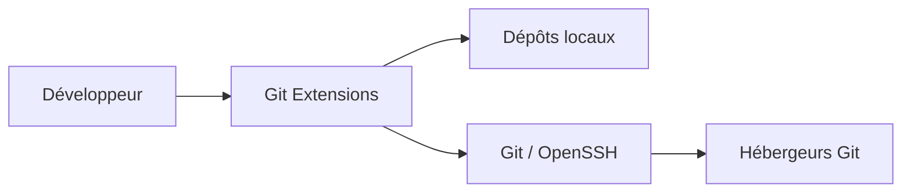
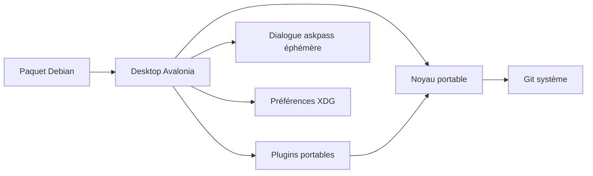

# C4 — migration Linux

## C1 · Contexte

Le développeur inspecte et modifie ses dépôts locaux ; les échanges distants passent par Git et les moyens d'authentification déjà configurés. Ne pas créer une seconde gestion des identifiants.

## C2 · Conteneurs

Application de bureau locale ; aucun serveur à déployer. Avalonia remplace progressivement WinForms ; `.deb` embarque le runtime .NET. L'ancienne solution Windows reste un repère fonctionnel pendant le portage.

## C3 · Composants / chemins

| Rôle | Point d'entrée |
| --- | --- |
| Build portable | `GitExtensions.Linux.slnx`, `src/linux/Directory.Build.props` |
| Navigation et workflows | `src/linux/GitExtensions.Desktop/` |
| Repères visuels et palettes originales | `ClassicStyles`, `CommitDialog`, `src/app/GitUI/Themes/`, `src/app/GitUI/Resources/Icons/` |
| Disposition Browse et touches d’accès | `MainWindow.Browser`, `MainWindow.Toolbar`, `MainWindow.Navigation`, `MainWindow.HistoryPresentation`, `CompactBrowserToolbar`, `RevisionHistoryRow`, `CommitGraph`, `BrowserLayoutPreferencesStore`, `MainWindow.Shortcuts`, `Localization/TranslationCatalog` |
| Undo de HEAD et Bisect historique | `MainWindow.Browser/Workflows`, `UndoLastCommitConfirmationDialog`, `BrowseCommandPreferencesStore`, `BisectDialog`, `GitRepository.Advanced/Bisect` |
| Combo Branches et expressions de filtre | `BranchHistoryFilterComboBox`, `MainWindow.BranchFilter`, `GitBranchFilter`, `GitLogQuery` |
| Menu Pull/Fetch et préférences du bouton | `MainWindow.Pull`, `PullDialog`, `PullPreferencesStore`, `GitRepository.Network`, `GitPullAction` original partagé |
| Push normal/rapide et reprise après rejet | `MainWindow.Workflows/Shortcuts/Toolbar`, `PushDialog`, `PushPreferencesStore`, `CloneSourcesStore`, `GitRepository.Push`, `GitPushRequest` |
| Menu et fenêtre Stash | `MainWindow.Stashes`, `StashDialog`, `ResetChangesDialog`, `StashPreferencesStore`, `GitRepository.Stashes` |
| Plugins portés, contrat et règles originales | `src/linux/GitExtensions.Plugins/`, `src/plugins/` |
| Gros fichiers et retrait des chemins de l’historique | `FindLargeFilesDialog`, `FindLargeFilesPlugin`, `GitRepository.HistoryRemoval`, `GitHistoryRemovalResult`, `GitProcessDialog` |
| Dashboard, récents et favoris | `DashboardControl`, `RepositoryHistoryStore`, `RepositoryHistoryPresentation`, `RecentRepositoriesSettingsDialog`, `MainWindow.Repositories` |
| Comparaisons et renommage | `CompareRevisionsDialog`, `GitRepository.Comparisons`, `GitBranchNaming`, `RenameBranchDialog`, `MainWindow.Comparisons` |
| Branches, tags et checkout | `MainWindow.Branches`, `GitRepository.References`, cinq `*BranchDialog`/`*TagDialog`, `ReferencePreferencesStore` |
| Cherry-pick et séquences sélectionnées | `GitRepository.CherryPick`, `CherryPickDialog`, `CherryPickSequence`, `CherryPickPreferencesStore`, `MainWindow.Workflows` |
| Retrait de sous-modules sans effacer les données | `GitRepository.SubmoduleRemoval`, `SubmoduleRemovalDialog`, `MainWindow.SubmoduleRemoval` |
| Mise à jour après checkout | `CheckoutSubmodulePrompt`, `SubmoduleUpdateDialog`, `SubmoduleCheckoutPreferencesStore`, `MainWindow.Plugins` |
| Messages et session de commit | `CommitDialog`, `CommitDraftStore`, `CommitPreferencesStore`, `CommitEmptyDialog`, `GitRepository.CommitMessages`, `GitRepository.CommitEncoding` |
| Proxy, Gource et avatars natifs | `ProxySwitcherDialog`, `GourceDialog`, `GourceAvatarProvider`, `GourceAvatarProtocol` |
| Création et clonage | `CloneDialog`, `InitDialog`, `CloneSourcesStore`, `GitRepository.CloneInit`, `GitRepository.CloneDefaults` |
| Historique fichier et attribution | `FileHistoryDialog`, `BlameDialog`, `BlameView`, `GitRepository.BlameHistory`, `GitRepository.BlameNavigation`, `BlamePreferencesStore` |
| Recherche dans les fichiers du commit | `MainWindow.Grep`, `FindInCommitFilesDialog`, `GitRepository.Grep`, `GitGrepModels`, `GitFileEncodingCodec` |
| Diffs de révision, séries et images | `MainWindow.Diffs`, `MainWindow.RangeDiff`, `DiffView`, `FileContentView`, `RevisionDiffPreferencesStore`, `GitRepository.Diffs`, `GitRepository.MergeDiffs`, `GitRepository.RangeDiffs` |
| Présentation colorée et patch canonique | `GitRepository.DiffDocuments`, `GitAnsiColorParser`, `GitDiffInlineHighlighter`, `GitDifftasticFormatter`, `DiffView`, `DiffViewerColors`, `DiffViewerPreferencesStore`, `DiffViewerAppearanceMenu` |
| Lecture, copies et encodages | `DiffViewerReadingMenu`, `FileHistoryContentView`, `FileContentView`, `GitDiffClipboard`, `GitFileEncodingCodec`, `GitEncodedPatch`, `GitRepository.FileEncoding` |
| Options, session et recherche du lecteur | `DiffViewerComparisonMenu`, `DiffViewerSearch`, `DiffViewerFindDialog`, `DiffViewerPopupLayout`, `NativeDiffViewerSettingsDialog`, `DiffViewerPreferencesStore` |
| Barre flottante et marqueurs du texte | `DiffViewerToolbar`, `DiffViewerRenderingMenu`, `DiffViewerRenderingBitmap`, `DiffViewerNonprintingRenderer`, `DiffView` |
| Listes de fichiers et provenance A/B | `GitRevisionFileClassifier`, `GitRepository.IndexFlags`, `FileStatusListBuilder`, `FileStatusListView`, `FileStatusListPreferencesStore`, `MainWindow.FileStatus`, `CommitDialog` |
| Exports, patches et maintenance | `ArchiveDialog`, `FormatPatchDialog`, `ApplyPatchDialog`, `MaintenanceDialog`, `GitRepository.Export*`, `GitRepository.Maintenance*` |
| Objets perdus, export blob et maintenance fsck | `RecoverLostObjectsDialog`, `GitRepository.Objects*`, `MainWindow.Browser/Exports`, dialogues Branch/Tag partagés |
| Nettoyage du worktree et sous-modules | `CleanupRepositoryDialog`, `MainWindow.Cleanup/Browser`, `GitRepository.Clean*`, `CleanMode` original partagé |
| Statistiques et graphiques historiques | `StatisticsDialog`, `GitImpactDialog`, `StatisticsPlugin`, `GitImpactPlugin` |
| Cycle de vie des plugins locaux | `MainWindow.Plugins`, `BackgroundFetchService`, `AutoCompileSubmodulesService` |
| Démarrage Browse/cleanup et protocole clipboard X11 | `Program`, `DesktopStartupArguments`, `DesktopStartupDispatcher`, `App`, `LinuxClipboardProtocol` |
| Authentification sans stockage de secrets | `AskpassApplication`, `gitextensions-askpass`, `GitRunner` |
| Merge et conflits index | `MergeBranchDialog`, `ResolveConflictsDialog`, `GitRepository.Merge/Conflicts`, `MergePreferencesStore`, `OriginalCommandHelp` |
| Reflog et récupération d’un commit disparu | `ReflogDialog`, `GitRepository.Advanced/ReflogEncoding`, `CreateBranchDialog`, `ResetCurrentBranchDialog`, `MainWindow.Browser/Workflows` |
| Reset et Revert | `ResetCurrentBranchDialog`, `ResetAnotherBranchDialog`, `RevertDialog/Sequence`, `GitRepository.ResetBranches/Reverts` |
| Reprise durable par worktree | `GitRepository.CherryPickRecovery`, `GetCherryPickRecoveryAsync`, `CherryPickDialog` |
| Rebase, reprise après Pull et coordination par worktree | `MainWindow.Rebase`, `RebaseDialog`, `NativeRebaseEditorApplication`, `GitRepository.Rebase.*` (état, journaux et lifecycle), `GitRebaseNativeEditor`, `GitRepository.Network`, `PullDialog` |
| Processus, annulation, octets et diagnostics Git | `GitRunner`, `GitProcessOutput`, `GitProcessLaunch/Group`, `Native/gitextensions-exec.c`, `GitOutputDecoding`, `GitRebaseOutputDecoder` |
| Progression Bisect et préférence de fermeture | `GitProcessDialog`, `ProcessDialogPreferencesStore`, `GitRepository.Bisect.Process` ; validation dans TODO |
| Contrats et parsers historiques réemployables | `src/app/GitCommands/`, `src/app/GitExtensions.Extensibility/` |
| Intégration bureau et paquet | `setup/linux/`, `eng/linux/` |
| Preuves comportementales | `tests/linux/`, `.github/workflows/linux.yml` |
| Référence du périmètre historique | `src/app/GitExtensions.Extensibility/Git/IGitUICommands.cs`, `src/app/GitUI/CommandsDialogs/`, `src/plugins/` |

C4 · Le détail des classes est dans le code ; pas de diagramme qui le duplique.
