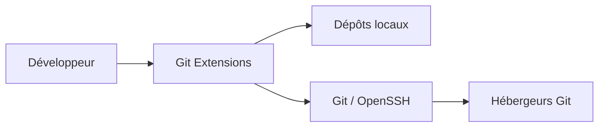
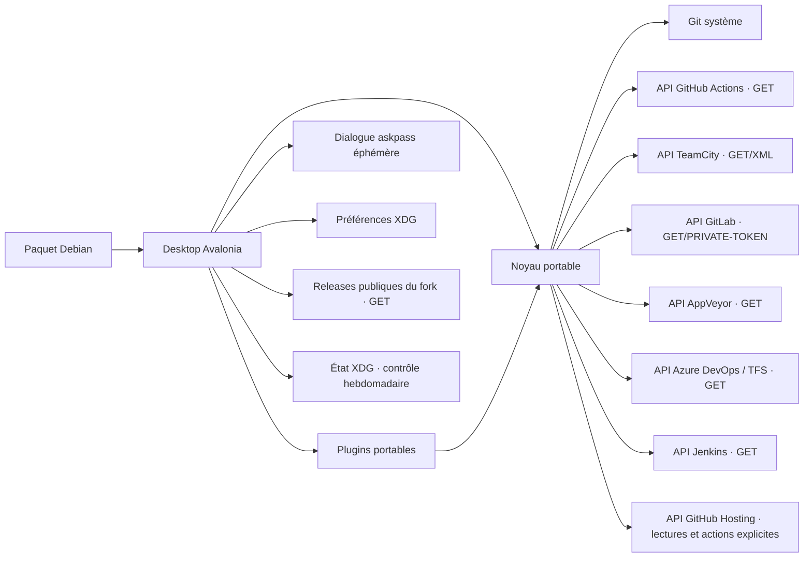

# C4 — migration Linux

## C1 · Contexte

Le développeur inspecte et modifie ses dépôts locaux ; les échanges Git passent par Git et les moyens d’authentification configurés. Le lecteur CI GitHub Actions utilise HTTP GET avec token explicitement choisi. Les pull requests GitHub disposent d’un client distinct et d’écritures explicites ; leurs identifiants locaux ne sont pas ceux de la page CI.

## C2 · Conteneurs

Application de bureau locale ; aucun serveur à déployer. Avalonia remplace progressivement WinForms ; `.deb` embarque le runtime .NET. L'ancienne solution Windows reste un repère fonctionnel pendant le portage.

## C3 · Composants / chemins

| Rôle | Point d'entrée |
| --- | --- |
| Build portable | `GitExtensions.Linux.slnx`, `src/linux/Directory.Build.props` |
| Navigation et workflows | `src/linux/GitExtensions.Desktop/` |
| Ouvrir un dépôt local | `OpenRepositoryDialog` → `GitRepository.Discovery` → noyau `MainWindow.OpenRepositoryAsync` ; candidat/runner réutilisés, MRU publié une seule fois, erreur possédée et lectures drainées ; combo/icônes/complétion partagés, [ADR0015](adr/workflows/repositories/0015-repository-history.md) |
| Repères visuels et palettes originales | `ClassicStyles`, `ClassicChrome.Group`, `ClassicChoiceAppearance` (cadres et choix compacts partagés), `CommitDialog`, `src/app/GitUI/Themes/`, `src/app/GitUI/Resources/Icons/` |
| Disposition Browse et touches d’accès | `MainWindow.Browser`, `MainWindow.Toolbar`, `MainWindow.Navigation`, `MainWindow.HistoryPresentation`, `CompactBrowserToolbar`, `RevisionHistoryRow`, `CommitGraph`, `BrowserLayoutPreferencesStore`, `MainWindow.Shortcuts`, `Localization/TranslationCatalog` |
| Informations du commit dans Browse, historique fichier et Blame | `CommitInformationView`, `CommitInformationPresentation`, `CommitInformationPreferencesStore`, `GitCommitInformation`, `GitRepository.CommitInformation`, `MainWindow.BrowserReads`, `FileHistoryDialog`, `BlameDialog` ; lectures différées, diagnostic attribué à sa lecture et fermeture drainée, ADR 0083 |
| Menu contextuel des commits et actions ciblées | `MainWindow.RevisionMenu/RevisionNavigation/RevisionAdvanced`, `ClassicMenuAppearance`, `MainWindow.Rebase/Comparisons`, `CommitDialog`, `GitRepository.Rebase.TargetedCommit`, `GitRebaseEditor.TargetedCommit` |
| Reprendre les flèches sur le commit du clic droit | `MainWindow.RevisionMenu`, `RevisionContextFocusTests` ; même origine pour sélection et navigation, focus des dialogues conservé (ADR 0076, périmètre clic droit testé) |
| Reprendre le clavier après une opération ou une modale Browse | `MainWindow.FocusRestoration/RunAsync`, `RevisionAction`, `HandleShortcutsAsync`, `HistoryMenuKeyDown`, `MainWindowBusyFocusTests` ; origine consommée une fois, nouvelle ligne résolue par hash, menu fermé avant commande (ADR 0079 ; Desktop 1241, activation du filtre et retours natifs ciblés vérifiés) |
| Conserver la saisie pendant une lecture Git | `RepositoryDialog.RunAsync/RestoreInputFocus`, `CreateBranchInitializationFocusTests` ; contrôle suivi conservé, fermeture et sous-dialogues prioritaires (ADR 0077, première frappe testée ; retour MainWindow et activation native distincts, ADR 0079) |
| Préparer les demandes de scripts sur le thread UI | `ScriptHostContext` → `ScriptPreparationDispatcher` → `ScriptTemplate` ; faits capturés une fois, demandes UI typées et BrowseCompletion attendu avant ExecutionPlan (ADR 0057/0078) ; ancre Browse capturée avant await et fitting partagé après mesure sous garde propriétaire (ADR0126, N2 ciblé) |
| Saisies demandées par les scripts | `QuickItemSelectorDialog`, `QuickStringSelectorDialog`, `FilePromptDialog`, `ScriptFilePickerDialog`, `SimplePromptDialog`, `ScriptInputDialogControls` ; consommées par le runtime, picker de scripts possédé et annulable sans override global (ADR 0078/0131) |
| Désambiguïser F2/Suppr sur les références d’un commit | `QuickGitRefSelectorDialog`, `MainWindow.QuickReferences`, `GitRepository.QuickReferences`, `ModalWindowActivation` ; choix typés puis dialogues de mutation partagés (ADR 0074, parcours Windows F2/Suppr) |
| Afficher une référence sur son commit sans perdre son identité de mutation | `GitReference.RevisionHash`, `GitRepository.ReferenceTargets`, `RevisionHistoryRow`, `CommitGraph`, `MainWindow.RevisionMenu` ; lecteur Linux commun fondé sur l’expression Windows, tooltip et badges synchronisés (ADR 0075) |
| Retrouver une révision parmi les lignes affichées sans relancer la requête d’historique | `MainWindow.QuickSearch`, `Controls/RevisionQuickSearch`, `RevisionSearchButton`, `GitCommit.FullMessage`, `GitLogQuery/GitOutputParser` ; sélection courante, annulation du collage et destinations artificielles typées, ADR0087 |
| Parcourir les parents/enfants du graphe affiché puis revenir par le même chemin | `MainWindow.ParentChildNavigation`, `Controls/ParentChildNavigationHistory`, `CommitGraphLayout.Children` ; commandes Navigate communes, ancres clavier/clic et sélection typée partagées, ADR0088 |
| Aller à un commit sans changer le filtre | `GoToCommitDialog`, `RepositorySourceControls`, `MainWindow.RevisionNavigation/BrowserReads`, `GitRepository.RevisionNavigation` ; trois sources Windows, choix explicites et lectures annulables (ADR 0073) |
| Undo de HEAD et Bisect historique/contextuel | `MainWindow.Browser/Workflows/RevisionMenu/RevisionBisect`, `UndoLastCommitConfirmationDialog`, `BrowseCommandPreferencesStore`, `BisectDialog`, `GitProcessDialog`, `GitRepository.Advanced/Bisect/Bisect.Process` ; fenêtre cinq actions distincte du menu Bad/Good/Skip/Stop sur SHA de la dernière ligne ciblée, fermetures Process distinctes et refresh/focus Windows ; ADR0051/0137, périmètre vérifié dans TODO |
| Gestion/création de Worktrees | `WorktreeDialog`, `CreateWorktreeDialog`, `WorktreeTable`, `WorktreeDialogControls`, `MainWindow.Worktrees/Navigation`, `GitRepository.Worktrees.*`, `WorktreeSnapshot` ; switch après le modal, suppression native gardée ; principal absorbé rattaché au checkout réciproque dans `GitRepository.Worktrees.Snapshots`, [ADR0106](adr/workflows/worktrees/0106-absorbed-main-checkout.md), Core ciblé distinct de la qualification Desktop/native |
| Ajout de sous-module | `AddSubmoduleDialog/Branches`, `RepositorySourceControls`, `MainWindow.Workflows`, `GitRepository.SubmoduleAdd.*`, `GitSubmoduleAddOptions` ; source/MRU partagés avec Clone/Remotes, Process natif et effets partiels conservés |
| Gestion des sous-modules | `SubmoduleRemovalDialog.*` partagé, `SubmoduleDialogPreferencesStore`, `GitRepository.Submodules.*`, `GitSubmoduleSnapshot`, `MainWindow.SubmoduleRemoval` ; commandes sur sélection revalidée, Add/Pull/Remove communs |
| Conflits de sous-modules | `SubmoduleConflictDialog.*`, `ConflictedPathDialog`, `CheckoutBranchConstraint`, `BrowseApplicationLauncher`, `GitRepository.SubmoduleConflict.*` ; stages capturés, vrai dépôt enfant, checkout commun et un seul staging sans commit parent |
| Rejoindre une référence du panneau gauche | `MainWindow.LeftPanelReferenceNavigation/BrowserReads` ; GoToRef annulable, Ctrl multisélection réelle récent d’abord, caret distinct et focus arbre sans filtre/reconstruction ; extension des endpoints artificiels ouverte ; ADR0125/0149 |
| Log et CommitDiff dédiés | `RevisionLogWindow`, `CommitDiffWindow`, `MainWindow.CommitDiff/CommitDiffMutationPublication`, `LockableNotifier/ILockableNotifier` Windows liés ; contexte du Browse exact partagé avec Log et ses enfants indépendants, Notify réservé à l’admission, verrous source/modal jusqu’au drain ; aucune relecture Log, attente du seul frontier RunAsync receveur ; ADR0144, qualification H28 dans TODO |
| Reprendre la fermeture d’un propriétaire après un veto asynchrone | `DeferredOwnerCloseReplay` observé par instance dans `RepositoryDialog` et `StartupRepositoryDialog` ; seule une vraie demande OwnerWindowClosing est rejouée après Closed ; tokens et drainage restent dans les bases, aucun abonnement global ; ADR0144 |
| Déplacer seulement la base du diff dans le graphe chargé | `MainWindow.ForkPointSelection` ; ordre SelectedRows WinForms, retoggle/collisions 3+, caret séparé ; publication atomique et adaptation Back/Forward conservées ; ADR0148 |
| Marquer les références puis filtrer explicitement | `MainWindow.NavigationSelection`, `MainWindow.ReferenceSorting`, `MainWindow.FocusedRevisionMenu` ; curseur et ensemble souligné distincts, identités complètes et garde dépôt/version ; ADR0149 |
| Éditer les options globales Commit sans écraser un autre éditeur | `CommitDialogSettingsSession/Page/Publication`, `CommitDialog.CommitPolicy`, `GitRepository.Staging/CommitEditor`, `CommitStagingReportDialog` ; neuf intentions partagées, staging au geste et message Git capturé à l’ouverture ; terminal/helper et verrou Core existants ; ADR0150 |
| Prévisualiser puis supprimer des branches obsolètes | `DeleteUnusedBranchesDialog`, `DeleteUnusedBranchesPreview/DeletionResult`, `DeleteUnusedBranchesPlugin`, `PluginDialog` ; cases, revalidation, leases et reçus acquis/possibles communs ; ADR0151 |
| Configurer les valeurs par défaut du nettoyage de branches | `DeleteUnusedBranchesSettingsPage/Session/Catalog` → `DistributedSettingsWorkspace` → `GitXmlSettingsStore` ; héritage GUID/ancien préfixe/JSON, Search temporaire ; `MainWindow.Plugins/ToolsHelp` garde owner/token et drainage ; ADR0151 |
| Lire un patch choisi sur disque | `ViewPatchDialog`, parseur Windows lié, `DiffView` readonly en patch fixe ; dernier aperçu accepté conservé jusqu’à publication complète, lecteurs/picker possédés ; ADR0143 |
| Signatures du commit et des tags annotés | `GitRepository.GpgVerification`, `GitGpgPresentation`, parseur Windows lié ; OID capturés, diagnostics distincts et publication sous garde de sélection ; ADR0145 |
| Arbres compacts sans saut de défilement | `ClassicTreeViewAppearance/ClassicTreeConnectors` partagés par navigation, fichiers, réglages, TeamCity et erreurs ; entêtes mesurées, révélation répétée stable, TreeView natif et décor non interactif ; ADR0061/0062 |
| Combo Branches et expressions de filtre | `BranchHistoryFilterComboBox`, `MainWindow.BranchFilter`, `GitBranchFilter`, `GitLogQuery` |
| Menus natifs communs et Tools/Help | `ClassicMenuAppearance`, `OriginalMenuItems`, `MainWindow.ToolsHelp`, `DesktopSettingsDialog`, `DesktopInformationWindow` ; `GitCommandLog/GitRunner` publient start/PID/fin vers `GitCommandLogWindow/GitCommandLogPresentation`, liste/détail par Id, copie/export explicites et abonnement retiré à Close ; `GitCommandLogCapturePolicy` fige les symboles bornés et le thread appelant avant askpass, `CommandLogCapturePreferences` publie la clé XML opt-in par CAS et `Program` draine les effets acquis hors UI (ADR0138/0139, preuves et limites dans TODO) ; statut/erreurs possédés → `DesktopErrorReporter`, `ExceptionReportSnapshot`, `BugReportDialog`, `ExceptionDetailsControl/ExceptionDetailDialog` (ADR0127, récupérable N2) |
| Journal des processus externes | `GitCommandLogProcessOperation` → outils/scripts/builds/console ; `LoggedExternalProcess` observe les applications détachées sans posséder leur durée ; PID/fin sûrs et attente UI distincte ; ADR0142, preuves et limites dans TODO |
| Retrouver la géométrie du journal | `CommandLogWindowPlacement/State` → état XDG séparé ; bornes normales et maximisation, activation F12 existante ; préchargement/drain possédé dans `Program` ; ADR0141, suites complètes/natif source borné/paquet/inventaire vérifiés séparément, limites dans TODO |
| Cache réel et inspection des résultats | `GitCommandCache` → lecteurs `GitRepository.CommandCache/Context` → `GitCommandLogWindow/GitCommandCachePresentation` ; admission explicite 50/LRU, contexte FS/env/config fermé, onglet de sorties réelles et Clear indépendant du journal sûr ; ADR0140 ; preuves et limites dans TODO, N2 inchangé |
| Recherche et notification des mises à jour | `MainWindow.Updates`, `UpdatesDialog`, `LinuxUpdateClient`, `LinuxReleaseVersion`, `UpdateCheckStateStore` ; recherche manuelle ou admission hebdomadaire au démarrage/refresh/Apply, canal choisi dans Advanced, état UTC sous XDG_STATE_HOME distinct des préférences, notification différée jusqu’à Browse disponible ; version/architecture et SHA-256, ouverture explicite du paquet ; ADR0132/0133 |
| Naviguer entre les réglages sans perdre les brouillons | `DesktopSettingsDialog`, `Controls/SettingsNavigationView`, `AppearanceFontsSettingsPage.AcceptSaved` ; arbre et recherche Windows, instances conservées, Apply/SaveAll puis Cancel, mémoire de session ; ADR0096 ; suites/paquet exact et natif source ciblé vérifiés, pages et portées restantes dans la matrice ; `ConfirmationsSettingsPage/Session` publie les profils existants avec reçus par fichier (ADR0125, dix-sept choix et consommateurs ; N2 partiel) ; `AdvancedSettingsPage/Session` raccorde neuf champs aux trois profils existants, reçus partiels et symbole Windows ; options Updates durables et masquage global de l’aide (ADR0129/0133/0134, N2 partiel) |
| Ouvrir les options avancées sans modifier les choix Git | `Controls/AdvancedOptionsVisibility.Capture`, constructeurs `PushDialog/MergeBranchDialog/RemotesDialog`, `MainWindow.FocusedRevisionMenu/RevisionMenu/Rebase/Scripts/Shortcuts` ; capture par fenêtre/popup, états locaux indépendants, défaut cosmétique false sans réparation ; noms complets/RevisionHash, Ctrl prioritaire et focus grille/arbre explicite ; `DesktopSettingsDialog.SaveAllAsync` traite la barrière de profil illisible, padding des éditeurs Push compact ; ADR0135, ciblé et natif source borné qualifiés ; suites complètes, paquet isolé et inventaire qualifiés séparément dans TODO |
| Personnaliser les raccourcis sans désynchroniser menus et gestes | `HotkeyCatalog`, `HotkeyBindings`, `HotkeyPreferencesStore`, `DesktopHotkeys`, `HotkeysSettingsPage`/`HotkeyCaptureTextBox` et dispatchers des hôtes ; ADR 0089 |
| Choisir la langue avant de construire les écrans | `LanguageCatalog`, `DesktopLanguage`, `ChooseLanguageDialog`, `DesktopSettingsDialog`, `PreferencesStore` ; bootstrap partagé, formatage OS préservé ; ADR0090 |
| Publier Appearance sans recharger la grille | `AppearanceSettingsPage/Session/Values`, `GeneralSettingsSession`, `HistoryViewPreferencesStore`, `RepositoryBranchMetadataService`, dashboard/récents ; intentions fusionnées, lignes conservées et annulation des waiters distincte des workers ; ADR0098, N2 partiel, full/paquet exact et natif source anglais/clair/X11 ciblé vérifiés ; `ColorsSettingsPage/Session` publie cinq options Graph via `HistoryViewPreferencesStore`, `RevisionHistoryRow` et `CommitGraph` sans promouvoir les autres choix View temporaires (ADR0128, N2 partiel) |
| Réglages Detailed, XML partagé et graphe | `DetailedSettingsPage/Session`, `GitDistributedSettingsSnapshot`, `GitXmlSettingsStore/Snapshot` partagé avec Dictionary ; `DetailedGraphSettings` publie les trois options globales aux graphes Browse/historique fichier/picker avec garde de profil/attachement ; `GitRepository.RemoteHeads`, `PushDialog`, `MergeBranchDialog/PreferencesStore` consomment les valeurs effectives ; [ADR0105](adr/preferences/detailed/0105-detailed-graph-and-xml-settings.md), [validation et limites](todo.md#detailed-et-worktrees-absorbés--qualification-partielle) |
| Dictionnaire et correction du message Commit | `GitExtensions.SpellChecking`, `DictionaryCatalog/SpellCheckService`, `CommitSpellingController`, `SpellingEditorView`, `GitRepository.DictionarySettings` et `XmlSerializableDictionary` Windows lié ; priorité local/distribué/global, user.dic par profil et fermeture drainée ; [ADR0101](adr/preferences/dictionary/0101-dictionary-and-commit-spelling.md), [preuves et limites](todo.md#dictionary--périmètre-vérifié), full03 et paquet03 isolé vérifiés, natif source anglais/clair/X11 ciblé accepté |
| Compléter le message sans remplacer son éditeur | `CommitDialog.RefreshDataAsync` → `GitCommitAutoCompleteProvider/Rules` → `CommitCompletionController` ; `Controls/ClassicCompletionList` partage les couleurs sélection/non-sélection avec Clone et les champs dépôt ; valeurs/extracteurs/matching Windows liés, corpus capturé, exemptions mémoire via `CommitSpellingController`/`SpellCheckService`, fermeture drainée ; [ADR0102](adr/preferences/commit-completion/0102-commit-message-completion.md), socle069 full02/paquet isolé/natif source borné vérifiés ; style8d9 ciblé106 et natif Commit vérifiés séparément |
| Préparer et valider un message depuis la bibliothèque applicative | `CommitMessagePreferences/Store`, `CommitMessageSettingsDialog`, `CommitMessageFormatting`, `CommitDialog.Templates` et `CommitTemplateRegistry` ; Saved par profil, formatage différé, `ClassicNumericInput/ClassicChoiceAppearance`, `Controls.MenuKeyboardSelection` et `WordWrapper` Windows lié ; bibliothèque distincte de `LoadTemplateAsync`/Git commit.template ; [ADR0103](adr/preferences/commit-templates/0103-commit-message-templates.md), fe1 ciblé214/13, natif source anglais/clair/X11 borné et paquet03 isolé vérifiés séparément ; N2 ciblé, full069 historique |
| Présenter les chemins sans remplacer les lignes | `Controls/FilePathPresentation`, `FilePathHeader`, `FileStatusListView`, canal par profil de `FileStatusListPreferencesStore` ; enum Windows, Desktop autoritaire, ADR0100 ; full vérifié par qualification complémentaire et paquet `5a61ab43c` vérifié, natif Diff/File tree anglais/clair/X11 ciblé ; [preuves et limites](todo.md#présentation-des-chemins--périmètre-vérifié) |
| Préférences Blame partagées | `BlameViewerSettingsPage/Session`, `BlamePreferencesStore`, `BlameView` ; dix choix globaux Query/Display, fusion des champs édités et retrait des images publiées avant destruction ; ADR0017 |
| Retrouver le fichier HEAD depuis la CLI | `SearchFileApplication`, `FileListFindDialog`, `Program` ; même sélecteur, résultat absolu seulement sur acceptation/stdout, lecture possédée ; ADR0080 |
| Comparaison du sous-module capturée par le parent | `FileMenuAdditionalOperations`, `BrowseRequest`, `BrowseApplicationLauncher` ; transport des deux gitlinks et revalidation avant lancement, sans checkout ; ADR0147 |
| Arguments Git des notes de version | `PluginDialog`, `ReleaseNotesGeneratorPlugin`, tokenizer et parseur Windows liés ; bornes résolues, argv littéraux et exports existants ; ADR0146 |
| Choisir quatre polices et le dessin EOL au prochain démarrage | `AppearanceFontsSettingsPage`, `FontPickerDialog`, `FontPreferencesStore`, `DesktopFonts/Session/Resolver/Metrics`, `ClassicStyles`, `DiffView/BlameView` et consommateurs des rôles ; snapshot de session au redémarrage, ADR0091 ; full/paquet b74 et natif anglais/clair/X11 vérifiés ; Fonts N2 borné, Appearance décrite dans son entrée dédiée |
| Garder le flux de fonte vivant pendant sa lecture native | `GitExtensions.Avalonia.Skia.Patched`, `GlyphTypefaceImpl.TryGetStream`, `font-stream-regression`, `FontStreamLifetimeTests` ; backend exact attribué et calibration bornée, ADR0092 |
| Images d’aide des commandes | `OriginalCommandHelpVisibility.Capture`, constructeurs `PullDialog/MergeBranchDialog/RebaseDialog`, `OriginalCommandHelp` ; le choix global supprime aide/toggle/colonne à l’ouverture, sans écrire les états Show/Hide locaux ; profil illisible conservé et aide visible par défaut ; footer Pull à libellé Stash mono-ligne et minimum mesuré une fois à Opened ; ADR0134, ciblé et natif source EN/FR bornés, paquet exact DPKG isolé vérifiés |
| Menu Pull/Fetch, sortie Process et préférences | `MainWindow.Pull`, `PullDialog/Layout/Source`, `OriginalCommandHelp`, gestion des remotes partagée, `GitProcessDialog`, `PullPreferencesStore`, `GitRepository.Network`, `GitPullAction` original partagé |
| Push normal/rapide/Commit et Process partagé | `MainWindow.Workflows/Shortcuts/Toolbar`, `CommitDialog`, `PushDialog`, `GitProcessDialog`, `GitProcessAttempts`, `PushPreferencesStore`, `CloneSourcesStore`, `GitRepository.Push`, `GitPushRequest` |
| Remotes et tracking partagés | `RemotesDialog.*`, `GitRepository.RemoteSettings.*`, `GitRemoteSettings`, `CloneSourcesStore`, `GitReference.RemoteColor`, `CommitGraph` ; colonnes tracking redimensionnables, copie native/AutoHeader et validations sérialisées ; ADR0067 |
| Menu et fenêtre Stash | `MainWindow.Stashes`, `StashDialog`, `ResetChangesDialog`, `StashPreferencesStore`, `GitRepository.Stashes` |
| Crédits Windows et console adaptée Linux | `ContributorsCatalog/Dialog`, ressource Windows liée ; `ConsoleStyleSettingsPage/Session/PreferencesStore/Presentation/Terminal`, `FontPickerDialog`, sorties Git raccordées et `InteractiveFileConsoleLauncher` ; [ADR0107](adr/ui/dialogs/0107-contributors-and-console-style.md), validation ciblée |
| Liens liés au commit courant | `GitRevisionLinkSettings/Parser/Templates`, `RevisionLinksSettingsPage/Session/Controller`, `CommitInformationView`, baseline `DistributedSettingsWorkspace` partagée avec Detailed/CI ; [ADR0108](adr/preferences/revision-links/0108-revision-links.md), validation ciblée |
| CI GitHub Actions en lecture seule | `GitHubActionsSettings/Page/Session/ApiClient/RunSnapshot`, `MainWindow.GitHubActions`, `RevisionHistoryRow` et lien Open report centré ; pages scoped et GET sans publication partielle, page de run ouverte explicitement dans le navigateur externe ; [ADR0109](adr/extensions/ci/0109-github-actions.md), validation ciblée |
| Fournisseurs CI et présentation partagée | `MainWindow.GitHubActions`, `BuildServerSource/Snapshot`, `BuildServerScopedSettingsPage`, `GitHubActionsSettingsSession` ; TeamCity et `BuildServerCredentialsStore` privé ([ADR0111](adr/extensions/ci/0111-teamcity.md)), `GitLabSettings/Page`, `GitLabApiClient/BuildSource/RemoteParser` et token XML choisi ([ADR0112](adr/extensions/ci/0112-gitlab.md)), `AppVeyorSettings/Page/ApiClient/BuildSource` ([ADR0113](adr/extensions/ci/0113-appveyor.md)), `AzureDevOpsSettings/Page/ApiClient/BuildSource` ([ADR0114](adr/extensions/ci/0114-azure-devops.md)) et `JenkinsSettings/Page/ApiClient/BuildSource` ([ADR0116](adr/extensions/ci/0116-jenkins.md)) ; polling/statuts et fermeture partagés, rapport HTML true encore partiel |
| Garder statut CI et rapport sur le même résultat | `BuildServerSnapshot.RevisionObservations`, `BuildServerRevisionProjection`, `MainWindow.GitHubActions/Hotkeys`, `BuildReportParityTests` ; représentant Windows StartDate/dernière observation modifiée, publication unique et lecture par SHA ; préférence + URL gouvernent la page, false affiche Open report centré, Ctrl+7 focalise son contrôle ; diagnostics hors onglet et invalidation dépôt/configuration, [ADR0136](adr/extensions/ci/0136-windows-build-report.md), ciblé/Core frais, natif GHA EN/FR local et paquet exact dans TODO |
| Pull requests et identifiants GitHub | `MainWindow.PullRequests`, `CreatePullRequestDialog`, `ViewPullRequestsDialog`, `PullRequestDialog`, `GitHubHostingClient/Settings/PreferencesStore`, `BuildServerCredentialsDialog` ; lecteurs et Checkout/Scripts partagés, API et token distincts de CI Actions ; [ADR0110](adr/extensions/github/0110-pull-requests.md) ; `MainWindow.ForkClone`, `ForkCloneDialog` étendent le même client Hosting avec sélection/parent liés à l’identité et effets partiels (ADR0124, N2 ciblé) |
| Issues assignées comme modèles de commit | `CommitDialog.GitHubIssues/Templates`, `GitHubIssueHelperSettings`, `GitHubIssueCommitTemplates`, `GitHubHostingClient.GetAssignedIssuesAsync`, `GitHubHostingSettingsDialog` ; snapshot privé, saisie/focus conservés et vraie lecture drainée à Closing ; [ADR0154](adr/extensions/github/0154-issue-commit-templates.md) |
| Aides et visualisation communes | `CommandlineHelpDialog/Application` et `Program` (ADR0119), `TextEditDialog`/Recovery Quick view (ADR0120), `SimpleHelpDisplayDialog`/Scripts (ADR0121), `DonateDialog/DonationsCatalog` (ADR0115) ; fontes, palettes et propriétaires partagés |
| Réglages Git avancés | `GitConfigAdvancedSettingsPage`, `GitToolsSettingsDialog/DraftSession`, `GitConfigurationFields`, writer Git natif ; Config/Advanced dans la même session (ADR0117) |
| Checkout ciblé et introduction Plugins | `CheckoutRevisionDialog` et workflow Before/native/After partagé (ADR0118) ; `PluginRootIntroductionPage` dans Settings (ADR0122) |
| Plugins portés, contrat et règles originales | `src/linux/GitExtensions.Plugins/`, `src/plugins/` |
| Gros fichiers et retrait des chemins de l’historique | `FindLargeFilesDialog`, `FindLargeFilesPlugin`, `GitRepository.HistoryRemoval`, `GitHistoryRemovalResult`, `GitProcessDialog` |
| Dashboard, récents et favoris | `DashboardControl`, `RepositoryHistoryStore`, `RepositoryHistoryPresentation`, `RecentRepositoriesSettingsDialog`, `MainWindow.Repositories` |
| Comparaisons, groupes et renommage | `CompareRevisionsDialog/Selection/Groups/FileMenus`, `FileStatusListView`, `GitRepository.Comparisons/ComparisonGroups`, `GitComparisonGroup`, `RevisionDiffPreferencesStore`, `GitBranchNaming`, `RenameBranchDialog`, `MainWindow.Comparisons` |
| Branches, tags et checkout | `MainWindow.Branches`, `GitRepository.References`, cinq `*BranchDialog`/`*TagDialog`, `ReferencePreferencesStore` |
| Cherry-pick et séquences sélectionnées | `GitRepository.CherryPick`, `CherryPickDialog`, `CherryPickSequence`, `CherryPickPreferencesStore`, `MainWindow.Workflows` |
| Retrait de sous-modules sans effacer les données | `GitRepository.SubmoduleRemoval`, `SubmoduleRemovalDialog`, `MainWindow.SubmoduleRemoval` |
| Mise à jour après checkout | `CheckoutSubmodulePrompt`, `SubmoduleUpdateDialog`, `SubmoduleCheckoutPreferencesStore`, `MainWindow.Plugins` |
| Messages et session de commit | `CommitDialog`, `CommitDraftStore`, `CommitPreferencesStore`, `CommitEmptyDialog`, `GitRepository.CommitMessages/CommitEncoding` ; branche/tracking : `CommitDialog.Branches`, `CreateBranchDialog.SuggestInitialNameAsync` ; index du parent : `CommitDialog.Superproject`, `GitRepository.Superproject`, `GitSuperprojectSnapshot` ; barre partagée : `CompactMenuToolbar`, décisions : `ClassicCommandLink` ; [ADR0104](adr/workflows/commits/0104-commit-branch-and-superproject.md) |
| Retrouver les fichiers masqués par un flag d’index | `CommitDialog.IndexFlags`, `IndexFlagFileList`, `CommitDialog.RefreshDataAsync/StageablePathsAsync`, `GitRepository.IndexFlags`, `FileStatusListView.SettingsMenu`, `RulesFileMenus` ; route Commit → Unstaged → Settings, bookmark du clic droit capturé à Opening après sélection ; ADR 0081 |
| Proxy, Gource et avatars natifs | `ProxySwitcherDialog`, `GourceDialog`, `GourceAvatarProvider`, `GourceAvatarProtocol` ; runtime commun `Avatars/AvatarService`, `AvatarWindowLifetime`, `AvatarImageControl`, `MainWindow.Avatars`, `App/Program` pour Browse/CommitInfo/Blame/Gource ; ADR0099, full/paquet isolé c831 et natif source local vérifiés ; éditeurs bornés et trois aides visibles avec un long draft, sans action externe ; Blame/Gource natifs et autres limites ouverts |
| Création, clonage et Process possédé | `CloneDialog`, `CloneDirectoryCompletion`, `InitDialog`, `GitProcessDialog`, `CloneSourcesStore`, `GitRepository.CloneInit`, `GitRepository.CloneDefaults` |
| Historique fichier et attribution | `FileHistoryWorkflow`, `BrowseApplicationLauncher`, `DesktopStartupArguments`, `MainWindow.FileHistory/FileHistoryBlame/BrowserReads/Lifetime`, `FileHistoryBlameController`, `GitRepository.FileHistoryGraph/ComparisonTree/ComparisonBlame`, `FileHistoryDialog`, `BlameDialog`, `BlameView`, `GitRepository.BlameHistory/BlameNavigation`, `BlamePreferencesStore`, `FileHistoryPreferencesStore`, `MainWindow.History/ToolsHelp`, `HistoryFilterDialog`, `GitRepository.GetRevisionGraphAsync` ; Browse indépendant, présélection sans borne, publication atomique, quatre réglages partagés et fermeture drainée, ADR0085/0086 |
| Choisir un fichier dans une liste sans modifier son filtre | `FileListFindDialog`, `FileStatusListContextMenuController`, chemins actuels/antérieurs capturés |
| Commandes fichier interactives dans un vrai terminal | `InteractiveFileConsoleLauncher/Application/Protocol`, `Program`, `GitInteractiveTerminalProcess`, `GitProcessLaunch/Group` ; acquittement avant Git, attente de fin avant libération (ADR 0080) |
| Recherche dans les fichiers du commit | `MainWindow.Grep`, `FindInCommitFilesDialog`, `GitRepository.Grep`, `GitGrepModels`, `GitFileEncodingCodec` |
| Configuration Git par portée et encodages partagés | `GitToolsSettingsDialog/Page/DraftSession`, `GitToolsCatalog`, `GitToolConfiguration`, `GitRepository.ToolConfiguration`, `AvailableEncodingsDialog/Catalog/PreferencesStore`, `DiffViewerReadingMenu`, `MainWindow.Workflows/ToolsHelp` ; treize champs, drafts et Apply/Cancel communs, préférences d’encodage indépendantes des écritures Git ; ADR0093/0094, niveaux et périmètres dans la matrice |
| Choisir Git et diagnostiquer son environnement sans dépôt | `GitEnvironmentSettingsPage`, `GitHomeDirectoryDialog`, `ChecklistSettingsPage`, `GitEnvironmentSettingsSession/PreferencesStore/Checklist/Startup`, `GitConfigurationContext`, `GitExecutionEnvironment`, `GitEnvironmentDiagnostics`, `MainWindow.GitEnvironment`, `Program` ; contexte capturé aux frontières raccordées, publications explicites et case de démarrage indépendante ; validation et limites dans ADR0095 |
| Choisir le client SSH sans perdre la configuration de session | `SshSettingsPage`, `GitEnvironmentSettingsSession/PreferencesStore`, `GitExecutionEnvironment`, `GitEnvironmentDiagnostics`, `GitEnvironmentChecklist`, `MainWindow.ToolsHelp` ; profil commun aux chemins, GIT_SSH littéral enfant, priorités natives et snapshots ; ADR0130 |
| Diffs de révision, séries et images | `MainWindow.Diffs`, `MainWindow.BrowserReads` (séquences annulables et onglets différés), `MainWindow.RangeDiff`, `DiffView`, `FileContentView`, `RevisionDiffPreferencesStore`, `GitRepository.Diffs`, `GitRepository.MergeDiffs`, `GitRepository.RangeDiffs` |
| Présentation colorée et patch canonique | `GitRepository.DiffDocuments`, `GitAnsiColorParser`, `GitDiffInlineHighlighter`, `GitDifftasticFormatter`, `DiffView`, `DiffViewerColors`, `DiffViewerPreferencesStore`, `DiffViewerAppearanceMenu` |
| Édition des règles du dépôt et ajout assisté | `RulesFileEditorDialog`, `AddToGitIgnoreDialog`, `RulesFileMenus`, `MainWindow.RulesFiles`, `CommitDialog.RulesFiles`, `DiffView`, `DiffViewerSearch`, `GitRepository.RulesFiles/IgnorePatterns`, `GitIgnorePatterns`, `GitRulesFile` |
| Lecture, copies et encodages | `DiffViewerReadingMenu`, `FileHistoryContentView`, `FileContentView`, `GitDiffClipboard`, `GitFileEncodingCodec`, `GitEncodedPatch`, `GitRepository.FileEncoding` |
| Options, session et recherche du lecteur | `DiffViewerComparisonMenu`, `DiffViewerSearch`, `DiffViewerFindDialog`, `DiffViewerPopupLayout`, `NativeDiffViewerSettingsDialog`, `DiffViewerPreferencesStore` |
| Barre flottante et marqueurs du texte | `DiffViewerToolbar`, `DiffViewerRenderingMenu`, `DiffViewerRenderingBitmap`, `DiffViewerNonprintingRenderer`, `DiffView` |
| Listes partagées Browse/Commit/Compare et provenance A/B | `FileStatusListContextMenuController`, `FileMenuPolicy/Operations/AdditionalOperations`, `MainWindow.FileMenus`, `CompareRevisionsDialog.FileMenus`, `GitComparisonFileMetadata`, `GitRepository.ComparisonFileMetadata/FileDiffTools/InteractiveFiles`, `FileStatusListView/Builder`, `FileStatusListPreferencesStore`, `ResetChangesDialog` (ADR0080) ; `FileEditorWorkflow/Dialog` → `EditableFileStore/IO` pour Edit et config brut (ADR0123), SimplePrompt pour Rename/Move (ADR0126), N2 ciblés |
| Sauvegarder les règles sparse sans modifier les fichiers | `SparseCheckoutDialog`, `GitRepository.SparseCheckout.Save`, `DeferredOwnerCloseReplay` ; Save distinct de Refresh, verrous Git et fermeture drainée ; ADR0152 |
| Choisir une révision depuis les dialogues | `ChooseCommitDialog/History`, `ChooseCommitSelectionPresenter`, `ExportRevisionList`, `IncrementalCommitGraphLayout`, `GitRepository.StreamRevisionGraphAsync`, `GitLogStreamParser`, `GitRunner.RunStreamingAsync`, `RevisionHistoryRow/Presentation/Columns`, `HistoryFilterDialog`, `ArtificialRevisionRows`, `CompareBranchPicker` ; parcours natif unique en lots attendus, plafond hérité/override privé, source/sélection/focus conservés et générations drainées ; insertion artificielle/menus complets encore ouverts, ADR0153 |
| Exports, patches et maintenance | `ArchiveDialog`, `FormatPatchDialog`, `ApplyPatchDialog`, `MaintenanceDialog`, `GitRepository.Export*`, `GitRepository.Maintenance*` |
| Objets perdus, export blob et maintenance fsck | `RecoverLostObjectsDialog`, `GitRepository.Objects*`, `MainWindow.Browser/Exports`, dialogues Branch/Tag partagés ; API Recovery fraîche avant aperçu/Quick view, contrat d’erreur objet supprimé conservé (ADR0140, C2 testé) |
| Nettoyage du worktree et sous-modules | `CleanupRepositoryDialog`, `MainWindow.Cleanup/Browser`, `GitRepository.Clean*`, `CleanMode` original partagé |
| Statistiques et graphiques historiques | `StatisticsDialog`, `GitImpactDialog`, `StatisticsPlugin`, `GitImpactPlugin` |
| Catalogue, préparation et exécution des scripts | `ScriptsSettingsPage`/`ScriptsPreferencesStore`, `Core/Scripts/ScriptArgumentPlan` et `ScriptProcessRunner` → cycle natif `GitRunner` ; `DesktopScriptExecutor`, `ScriptMenuItems`, `MainWindow.Scripts`, `CommitDialog.Scripts` et `ScriptWorkflowScope` pour les hôtes/événements (ADR 0057) ; scripts Git aux lectures externes non fermées exécutés sans réutilisation du cache (ADR0140, C2 testé) |
| Cycle de vie et défauts des plugins locaux | `MainWindow.Plugins/SimplePluginSettings`, `BackgroundFetchService`, `AutoCompileSubmodulesService`, `PluginScopedSettingsSession/Page`, `BackgroundFetchSettingsSession`, `SimplePluginSettingsCatalog/Session`, `ProxySwitcherSettingsSession` ; mêmes champs XML Local/Distributed/Global dans Settings, intentions acquittées par fichier, options d’invocation distinctes ; ADR0008/0014 |
| Démarrage Browse/cleanup et protocole clipboard X11 | `Program`, `DesktopStartupArguments`, `DesktopStartupDispatcher`, `App`, `LinuxClipboardProtocol` |
| Authentification sans stockage de secrets | `AskpassProtocol`, `AskpassApplication`, `AskpassWindow`, `gitextensions-askpass`, `GitRunner` ; réponses typées, confirmation et notification distinctes (ADR 0072) |
| Merge et conflits index | `MergeBranchDialog`, `ResolveConflictsDialog`, `GitRepository.Merge/Conflicts`, `MergePreferencesStore`, `OriginalCommandHelp` |
| Reflog et récupération d’un commit disparu | `ReflogDialog`, `GitRepository.Advanced/ReflogEncoding`, `CreateBranchDialog`, `ResetCurrentBranchDialog`, `MainWindow.Browser/Workflows` |
| Reset et Revert | `ResetCurrentBranchDialog`, `ResetAnotherBranchDialog`, `RevertDialog/Sequence`, `GitRepository.ResetBranches/Reverts` |
| Reprise durable par worktree | `GitRepository.CherryPickRecovery`, `GetCherryPickRecoveryAsync`, `CherryPickDialog` |
| Rebase, reprise après Pull et coordination par worktree | `MainWindow.Rebase`, `RebaseDialog`, `NativeRebaseEditorApplication`, `GitRepository.Rebase.*` (état, journaux et lifecycle), `GitRebaseNativeEditor`, `GitRepository.Network`, `PullDialog` |
| Processus, annulation, octets et diagnostics Git | `GitRunner`, `GitProcessOutput`, `GitProcessLaunch/Group`, `LinuxUnixSocketDirectory`, `Native/gitextensions-exec.c`, `GitOutputDecoding`, `GitRebaseOutputDecoder` ; répertoire de contrôle privé, chemin UTF-8 borné pour Git et console interactive (ADR 0084) |
| Progression Bisect et préférence de fermeture | `GitProcessDialog`, `ProcessDialogPreferencesStore`, `GitRepository.Bisect.Process` ; validation dans TODO |
| Contrats et parsers historiques réemployables | `src/app/GitCommands/`, `src/app/GitExtensions.Extensibility/` |
| Intégration bureau et paquet | `setup/linux/`, `eng/linux/` |
| Preuves comportementales | `tests/linux/`, `.github/workflows/linux.yml` |
| Référence du périmètre historique | `src/app/GitExtensions.Extensibility/Git/IGitUICommands.cs`, `src/app/GitUI/CommandsDialogs/`, `src/plugins/` |

C4 · Le détail des classes est dans le code ; pas de diagramme qui le duplique.

## Menus de l’historique

`MainWindow.HistoryMenus` partage View/Navigate entre barre, clic droit et raccourcis (ADR 0064). `MainWindow.HistoryView` applique les options sans recréer les lignes ; `RevisionHistoryRow` et `CommitGraph` publient la présentation et les références filtrées. `HistoryViewPreferencesStore` garde les défauts XDG explicites. `GitLogQuery` sélectionne les tris Git et les références stash/session. Commit porte le staging parent ciblé ([ADR0104](adr/workflows/commits/0104-commit-branch-and-superproject.md)). GitHub Actions (ADR0109), TeamCity (ADR0111), GitLab (ADR0112), AppVeyor (ADR0113), Azure DevOps (ADR0114) et Jenkins (ADR0116) partagent le suivi CI ; les autres fournisseurs et la parité globale restent ouverts. Scripts fournit un catalogue dynamique par ID, toolbar, menus et raccourcis vers DesktopScriptExecutor ; ses variantes natives restent à auditer.

Le popup de références reprend le choix Windows ciblé/Other actions : Maj ou AlwaysAdvanced l’ouvrent complet, Ctrl prioritaire le garde ciblé ; les deux formes conservent l’identité complète de la ref cliquée, y compris les tags annotés. Hors badge/clavier et nouvelle ouverture n’héritent pas de l’ancien contexte. Select in left panel révèle la ref sans filtrer ni reconstruire l’historique et prend explicitement le focus de l’arbre. [ADR0135](adr/preferences/advanced/0135-shared-advanced-options.md), ciblé ac59 et natif source X11 EN/FR borné qualifiés ; suites complètes, paquet isolé et inventaire qualifiés séparément dans TODO ; autres menus et familles ouverts.

## Tri et préférences

`GeneralSettingsPage` garde le brouillon Windows ; `GeneralSettingsSession` fusionne les seuls champs édités dans les profils existants. `HistoryLoadingPolicy` sépare plafond global et lots ; `GlobalDiffPreferences` partage Histogram avec Blame. `MainWindow.GeneralSettings` raccorde les compteurs et les statuts Git optionnels. `ClassicNumericInput` partage les champs compacts avec les réglages des dépôts récents. ADR [0097](adr/preferences/general/0097-general-settings-policies.md).

`GitReferenceSorting` et `GitReferencePriorities` partagent les tris Windows entre lecteurs Core et panneau gauche : tri natif avant limites, priorités avant dossiers. `MainWindow.ReferenceSorting` relit les références ; changer le tri de l’historique relance sa propre lecture. GitDefault n’impose aucun flag au lecteur ; la grille conserve séparément l’ordre du graphe Windows. View reste en session ; Sort conserve sa publication Settings historique et Save as default sauvegarde la vue. Colors ajoute les seules intentions éditées parmi ses cinq options Graph (ADR0128, N2 partiel), distinctes des autres choix temporaires. ADR [0082](adr/preferences/sorting/0082-native-reference-sorting.md). CommitInfo garde son comparateur de branches et son scan de filtrage Windows distincts ; ADR [0083](adr/ui/history/0083-shared-commit-information.md).

## Environnement Git et diagnostic au démarrage

`GitEnvironment` publie les choix XDG pour la prochaine frontière d’exécution des dépôts déjà ouverts ; `GitExecutionEnvironment` garde le contexte capturé aux frontières `BeginOperation` raccordées (commandes, Main Run/Refresh, clone/init, scripts, configuration, reprise CLI et mutations). `ReadBrowserAsync` n’impose pas un snapshot global à toutes ses lectures UI successives ; audit ouvert. Le répertoire d’outils est ajouté en fin de PATH ; HOME personnalisé est limité aux enfants, sans changer la session ou USERPROFILE. `GIT_CONFIG_GLOBAL` garde sa priorité. Le contexte Config Global hors dépôt retire les redirections de dépôt et préserve les origines des chemins relatifs avant d’utiliser un cwd privé.

Les neuf lignes de Checklist observent les réglages publiés : SSH local sans authentification, outils configurés sans exécution. La case de démarrage est sauvegardée seule et s’éteint après un résultat entièrement Good ; Save and rescan publie les pages avant la lecture native. Cancel et fermeture conservent les publications acquises et drainent les acteurs connus. [ADR0095](adr/preferences/environment/0095-git-environment-and-checklist.md) : suites et paquet vérifiés sur 1deed, parcours source Git/HOME/démarrage et Global hors dépôt bornés anglais/clair/X11 ; l’arbre Settings complet et la parité globale restent ouverts. Les seuils de diagnostic **2.43/2.53** restent distincts du minimum Linux **2.38**.

## Inventaire de portage par écran

[La matrice Windows → Linux](windows-linux-window-inventory.md) recense les fenêtres, paramètres, équivalents et écarts. `eng/linux/window-inventory` joint un relevé syntaxique Roslyn (héritage/parties Designer/allocations) à des évaluations explicites ; son contrôle bloque les types non classés et liens cassés. Les exports Markdown/CSV/JSON distinguent état fonctionnel, aspect et preuve de test ; ils ne remplacent pas un audit de parité.

## Suppression distante

`DeleteRemoteBranchDialog` partage `BranchSelectionComboBox`/`SelectMultipleBranchesDialog`, `GitProcessDialog` et `DeleteBranchDialog` entre ses points d’entrée. `GitRepository.RemoteBranchDeletion` produit l’aperçu puis les résultats atomiques par remote ; le nettoyage local dépend seulement des succès prouvés. Le chemin événementiel entoure chaque batch distant de Before/AfterPush et de son Process, hors mutex UI ; sans scripts configurés, le chemin legacy conserve son Process unique. Hashes/URL/leases sont revalidés avant chaque batch, sans transaction contre tout éditeur externe (ADR 0065/0057).
