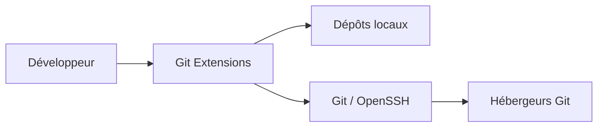
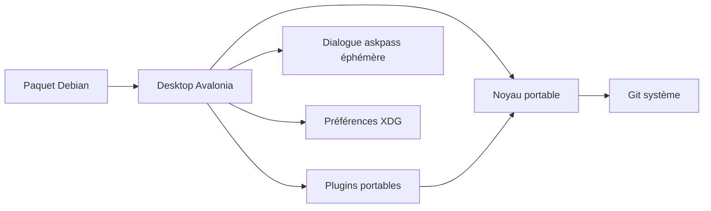

# C4 — migration Linux

## C1 · Contexte

Le développeur inspecte et modifie ses dépôts locaux ; les échanges distants passent par Git et les moyens d'authentification déjà configurés. Ne pas créer une seconde gestion des identifiants.

## C2 · Conteneurs

Application de bureau locale ; aucun serveur à déployer. Avalonia remplace progressivement WinForms ; `.deb` embarque le runtime .NET. L'ancienne solution Windows reste un repère fonctionnel pendant le portage.

## C3 · Composants / chemins

| Rôle | Point d'entrée |
| --- | --- |
| Build portable | `GitExtensions.Linux.slnx`, `src/linux/Directory.Build.props` |
| Navigation et workflows | `src/linux/GitExtensions.Desktop/` |
| Repères visuels et palettes originales | `ClassicStyles`, `ClassicChrome.Group`, `ClassicChoiceAppearance` (cadres et choix compacts partagés), `CommitDialog`, `src/app/GitUI/Themes/`, `src/app/GitUI/Resources/Icons/` |
| Disposition Browse et touches d’accès | `MainWindow.Browser`, `MainWindow.Toolbar`, `MainWindow.Navigation`, `MainWindow.HistoryPresentation`, `CompactBrowserToolbar`, `RevisionHistoryRow`, `CommitGraph`, `BrowserLayoutPreferencesStore`, `MainWindow.Shortcuts`, `Localization/TranslationCatalog` |
| Informations du commit dans Browse, historique fichier et Blame | `CommitInformationView`, `CommitInformationPresentation`, `CommitInformationPreferencesStore`, `GitCommitInformation`, `GitRepository.CommitInformation`, `MainWindow.BrowserReads`, `FileHistoryDialog`, `BlameDialog` ; lectures différées, diagnostic attribué à sa lecture et fermeture drainée, ADR 0083 |
| Menu contextuel des commits et actions ciblées | `MainWindow.RevisionMenu/RevisionNavigation/RevisionAdvanced`, `ClassicMenuAppearance`, `MainWindow.Rebase/Comparisons`, `CommitDialog`, `GitRepository.Rebase.TargetedCommit`, `GitRebaseEditor.TargetedCommit` |
| Reprendre les flèches sur le commit du clic droit | `MainWindow.RevisionMenu`, `RevisionContextFocusTests` ; même origine pour sélection et navigation, focus des dialogues conservé (ADR 0076, périmètre clic droit testé) |
| Reprendre le clavier après une opération ou une modale Browse | `MainWindow.FocusRestoration/RunAsync`, `RevisionAction`, `HandleShortcutsAsync`, `HistoryMenuKeyDown`, `MainWindowBusyFocusTests` ; origine consommée une fois, nouvelle ligne résolue par hash, menu fermé avant commande (ADR 0079 ; Desktop 1241, activation du filtre et retours natifs ciblés vérifiés) |
| Conserver la saisie pendant une lecture Git | `RepositoryDialog.RunAsync/RestoreInputFocus`, `CreateBranchInitializationFocusTests` ; contrôle suivi conservé, fermeture et sous-dialogues prioritaires (ADR 0077, première frappe testée ; retour MainWindow et activation native distincts, ADR 0079) |
| Préparer les demandes de scripts sur le thread UI | `ScriptHostContext` → `ScriptPreparationDispatcher` → `ScriptTemplate` ; faits capturés une fois, demandes UI typées et BrowseCompletion attendu avant ExecutionPlan (ADR 0057/0078) |
| Saisies demandées par les scripts | `QuickItemSelectorDialog`, `QuickStringSelectorDialog`, `FilePromptDialog`, `SimplePromptDialog`, `ScriptInputDialogControls` ; consommées par le runtime, limites du picker natif conservées (ADR 0078) |
| Désambiguïser F2/Suppr sur les références d’un commit | `QuickGitRefSelectorDialog`, `MainWindow.QuickReferences`, `GitRepository.QuickReferences`, `ModalWindowActivation` ; choix typés puis dialogues de mutation partagés (ADR 0074, parcours Windows F2/Suppr) |
| Afficher une référence sur son commit sans perdre son identité de mutation | `GitReference.RevisionHash`, `GitRepository.ReferenceTargets`, `RevisionHistoryRow`, `CommitGraph`, `MainWindow.RevisionMenu` ; lecteur Linux commun fondé sur l’expression Windows, tooltip et badges synchronisés (ADR 0075) |
| Retrouver une révision parmi les lignes affichées sans relancer la requête d’historique | `MainWindow.QuickSearch`, `Controls/RevisionQuickSearch`, `RevisionSearchButton`, `GitCommit.FullMessage`, `GitLogQuery/GitOutputParser` ; sélection courante, annulation du collage et destinations artificielles typées, ADR0087 |
| Parcourir les parents/enfants du graphe affiché puis revenir par le même chemin | `MainWindow.ParentChildNavigation`, `Controls/ParentChildNavigationHistory`, `CommitGraphLayout.Children` ; commandes Navigate communes, ancres clavier/clic et sélection typée partagées, ADR0088 |
| Aller à un commit sans changer le filtre | `GoToCommitDialog`, `RepositorySourceControls`, `MainWindow.RevisionNavigation/BrowserReads`, `GitRepository.RevisionNavigation` ; trois sources Windows, choix explicites et lectures annulables (ADR 0073) |
| Undo de HEAD et Bisect historique | `MainWindow.Browser/Workflows`, `UndoLastCommitConfirmationDialog`, `BrowseCommandPreferencesStore`, `BisectDialog`, `GitRepository.Advanced/Bisect` |
| Gestion/création de Worktrees | `WorktreeDialog`, `CreateWorktreeDialog`, `WorktreeTable`, `WorktreeDialogControls`, `MainWindow.Worktrees/Navigation`, `GitRepository.Worktrees.*`, `WorktreeSnapshot` ; switch après le modal, suppression native gardée |
| Ajout de sous-module | `AddSubmoduleDialog/Branches`, `RepositorySourceControls`, `MainWindow.Workflows`, `GitRepository.SubmoduleAdd.*`, `GitSubmoduleAddOptions` ; source/MRU partagés avec Clone/Remotes, Process natif et effets partiels conservés |
| Gestion des sous-modules | `SubmoduleRemovalDialog.*` partagé, `SubmoduleDialogPreferencesStore`, `GitRepository.Submodules.*`, `GitSubmoduleSnapshot`, `MainWindow.SubmoduleRemoval` ; commandes sur sélection revalidée, Add/Pull/Remove communs |
| Conflits de sous-modules | `SubmoduleConflictDialog.*`, `ConflictedPathDialog`, `CheckoutBranchConstraint`, `BrowseApplicationLauncher`, `GitRepository.SubmoduleConflict.*` ; stages capturés, vrai dépôt enfant, checkout commun et un seul staging sans commit parent |
| Arbre Browse compact | `MainWindow.Navigation`, `ClassicTreeViewAppearance`, `ClassicTreeConnectors`, PNG Windows partagés ; contrôle TreeView natif et décor non interactif |
| Combo Branches et expressions de filtre | `BranchHistoryFilterComboBox`, `MainWindow.BranchFilter`, `GitBranchFilter`, `GitLogQuery` |
| Menus natifs communs et Tools/Help | `ClassicMenuAppearance`, `OriginalMenuItems`, `MainWindow.ToolsHelp`, `DesktopSettingsDialog`, `DesktopInformationWindow`, `GitCommandLogWindow`, journal Core `GitCommandLog` borné en mémoire |
| Naviguer entre les réglages sans perdre les brouillons | `DesktopSettingsDialog`, `Controls/SettingsNavigationView`, `AppearanceFontsSettingsPage.AcceptSaved` ; arbre et recherche Windows, instances conservées, Apply/SaveAll puis Cancel, mémoire de session ; ADR0096 ; suites/paquet exact et natif source ciblé vérifiés, pages et portées restantes dans la matrice |
| Personnaliser les raccourcis sans désynchroniser menus et gestes | `HotkeyCatalog`, `HotkeyBindings`, `HotkeyPreferencesStore`, `DesktopHotkeys`, `HotkeysSettingsPage`/`HotkeyCaptureTextBox` et dispatchers des hôtes ; ADR 0089 |
| Choisir la langue avant de construire les écrans | `LanguageCatalog`, `DesktopLanguage`, `ChooseLanguageDialog`, `DesktopSettingsDialog`, `PreferencesStore` ; bootstrap partagé, formatage OS préservé ; ADR0090 |
| Choisir quatre polices et le dessin EOL au prochain démarrage | `AppearanceFontsSettingsPage`, `FontPickerDialog`, `FontPreferencesStore`, `DesktopFonts/Session/Resolver/Metrics`, `ClassicStyles`, `DiffView/BlameView` et consommateurs des rôles ; snapshot de session au redémarrage, ADR0091 ; full/paquet b74 et natif anglais/clair/X11 vérifiés ; Fonts N2 borné, Appearance N1 |
| Garder le flux de fonte vivant pendant sa lecture native | `GitExtensions.Avalonia.Skia.Patched`, `GlyphTypefaceImpl.TryGetStream`, `font-stream-regression`, `FontStreamLifetimeTests` ; backend exact attribué et calibration bornée, ADR0092 |
| Menu Pull/Fetch, sortie Process et préférences | `MainWindow.Pull`, `PullDialog/Layout/Source`, `OriginalCommandHelp`, gestion des remotes partagée, `GitProcessDialog`, `PullPreferencesStore`, `GitRepository.Network`, `GitPullAction` original partagé |
| Push normal/rapide/Commit et Process partagé | `MainWindow.Workflows/Shortcuts/Toolbar`, `CommitDialog`, `PushDialog`, `GitProcessDialog`, `GitProcessAttempts`, `PushPreferencesStore`, `CloneSourcesStore`, `GitRepository.Push`, `GitPushRequest` |
| Remotes et tracking partagés | `RemotesDialog.*`, `GitRepository.RemoteSettings.*`, `GitRemoteSettings`, `CloneSourcesStore`, `GitReference.RemoteColor`, `CommitGraph` ; ADR 0067 |
| Menu et fenêtre Stash | `MainWindow.Stashes`, `StashDialog`, `ResetChangesDialog`, `StashPreferencesStore`, `GitRepository.Stashes` |
| Plugins portés, contrat et règles originales | `src/linux/GitExtensions.Plugins/`, `src/plugins/` |
| Gros fichiers et retrait des chemins de l’historique | `FindLargeFilesDialog`, `FindLargeFilesPlugin`, `GitRepository.HistoryRemoval`, `GitHistoryRemovalResult`, `GitProcessDialog` |
| Dashboard, récents et favoris | `DashboardControl`, `RepositoryHistoryStore`, `RepositoryHistoryPresentation`, `RecentRepositoriesSettingsDialog`, `MainWindow.Repositories` |
| Comparaisons, groupes et renommage | `CompareRevisionsDialog/Selection/Groups/FileMenus`, `FileStatusListView`, `GitRepository.Comparisons/ComparisonGroups`, `GitComparisonGroup`, `RevisionDiffPreferencesStore`, `GitBranchNaming`, `RenameBranchDialog`, `MainWindow.Comparisons` |
| Branches, tags et checkout | `MainWindow.Branches`, `GitRepository.References`, cinq `*BranchDialog`/`*TagDialog`, `ReferencePreferencesStore` |
| Cherry-pick et séquences sélectionnées | `GitRepository.CherryPick`, `CherryPickDialog`, `CherryPickSequence`, `CherryPickPreferencesStore`, `MainWindow.Workflows` |
| Retrait de sous-modules sans effacer les données | `GitRepository.SubmoduleRemoval`, `SubmoduleRemovalDialog`, `MainWindow.SubmoduleRemoval` |
| Mise à jour après checkout | `CheckoutSubmodulePrompt`, `SubmoduleUpdateDialog`, `SubmoduleCheckoutPreferencesStore`, `MainWindow.Plugins` |
| Messages et session de commit | `CommitDialog`, `CommitDraftStore`, `CommitPreferencesStore`, `CommitEmptyDialog`, `GitRepository.CommitMessages`, `GitRepository.CommitEncoding` |
| Retrouver les fichiers masqués par un flag d’index | `CommitDialog.IndexFlags`, `IndexFlagFileList`, `CommitDialog.RefreshDataAsync/StageablePathsAsync`, `GitRepository.IndexFlags`, `FileStatusListView.SettingsMenu`, `RulesFileMenus` ; route Commit → Unstaged → Settings, bookmark du clic droit capturé à Opening après sélection ; ADR 0081 |
| Proxy, Gource et avatars natifs | `ProxySwitcherDialog`, `GourceDialog`, `GourceAvatarProvider`, `GourceAvatarProtocol` |
| Création, clonage et Process possédé | `CloneDialog`, `CloneDirectoryCompletion`, `InitDialog`, `GitProcessDialog`, `CloneSourcesStore`, `GitRepository.CloneInit`, `GitRepository.CloneDefaults` |
| Historique fichier et attribution | `FileHistoryWorkflow`, `BrowseApplicationLauncher`, `DesktopStartupArguments`, `MainWindow.FileHistory/FileHistoryBlame/BrowserReads/Lifetime`, `FileHistoryBlameController`, `GitRepository.FileHistoryGraph/ComparisonTree/ComparisonBlame`, `FileHistoryDialog`, `BlameDialog`, `BlameView`, `GitRepository.BlameHistory/BlameNavigation`, `BlamePreferencesStore`, `FileHistoryPreferencesStore`, `MainWindow.History/ToolsHelp`, `HistoryFilterDialog`, `GitRepository.GetRevisionGraphAsync` ; Browse indépendant, présélection sans borne, publication atomique, quatre réglages partagés et fermeture drainée, ADR0085/0086 |
| Choisir un fichier dans une liste sans modifier son filtre | `FileListFindDialog`, `FileStatusListContextMenuController`, chemins actuels/antérieurs capturés |
| Commandes fichier interactives dans un vrai terminal | `InteractiveFileConsoleLauncher/Application/Protocol`, `Program`, `GitInteractiveTerminalProcess`, `GitProcessLaunch/Group` ; acquittement avant Git, attente de fin avant libération (ADR 0080) |
| Recherche dans les fichiers du commit | `MainWindow.Grep`, `FindInCommitFilesDialog`, `GitRepository.Grep`, `GitGrepModels`, `GitFileEncodingCodec` |
| Configuration Git par portée et encodages partagés | `GitToolsSettingsDialog/Page/DraftSession`, `GitToolsCatalog`, `GitToolConfiguration`, `GitRepository.ToolConfiguration`, `AvailableEncodingsDialog/Catalog/PreferencesStore`, `DiffViewerReadingMenu`, `MainWindow.Workflows/ToolsHelp` ; treize champs, drafts et Apply/Cancel communs, préférences d’encodage indépendantes des écritures Git ; ADR0093/0094, niveaux et périmètres dans la matrice |
| Choisir Git et diagnostiquer son environnement sans dépôt | `GitEnvironmentSettingsPage`, `GitHomeDirectoryDialog`, `ChecklistSettingsPage`, `GitEnvironmentSettingsSession/PreferencesStore/Checklist/Startup`, `GitConfigurationContext`, `GitExecutionEnvironment`, `GitEnvironmentDiagnostics`, `MainWindow.GitEnvironment`, `Program` ; contexte capturé aux frontières raccordées, publications explicites et case de démarrage indépendante ; validation et limites dans ADR0095 |
| Diffs de révision, séries et images | `MainWindow.Diffs`, `MainWindow.BrowserReads` (séquences annulables et onglets différés), `MainWindow.RangeDiff`, `DiffView`, `FileContentView`, `RevisionDiffPreferencesStore`, `GitRepository.Diffs`, `GitRepository.MergeDiffs`, `GitRepository.RangeDiffs` |
| Présentation colorée et patch canonique | `GitRepository.DiffDocuments`, `GitAnsiColorParser`, `GitDiffInlineHighlighter`, `GitDifftasticFormatter`, `DiffView`, `DiffViewerColors`, `DiffViewerPreferencesStore`, `DiffViewerAppearanceMenu` |
| Édition des règles du dépôt et ajout assisté | `RulesFileEditorDialog`, `AddToGitIgnoreDialog`, `RulesFileMenus`, `MainWindow.RulesFiles`, `CommitDialog.RulesFiles`, `DiffView`, `DiffViewerSearch`, `GitRepository.RulesFiles/IgnorePatterns`, `GitIgnorePatterns`, `GitRulesFile` |
| Lecture, copies et encodages | `DiffViewerReadingMenu`, `FileHistoryContentView`, `FileContentView`, `GitDiffClipboard`, `GitFileEncodingCodec`, `GitEncodedPatch`, `GitRepository.FileEncoding` |
| Options, session et recherche du lecteur | `DiffViewerComparisonMenu`, `DiffViewerSearch`, `DiffViewerFindDialog`, `DiffViewerPopupLayout`, `NativeDiffViewerSettingsDialog`, `DiffViewerPreferencesStore` |
| Barre flottante et marqueurs du texte | `DiffViewerToolbar`, `DiffViewerRenderingMenu`, `DiffViewerRenderingBitmap`, `DiffViewerNonprintingRenderer`, `DiffView` |
| Listes partagées Browse/Commit/Compare et provenance A/B | `FileStatusListContextMenuController`, `FileMenuPolicy/Operations/AdditionalOperations`, `MainWindow.FileMenus`, `CompareRevisionsDialog.FileMenus`, `GitComparisonFileMetadata`, `GitRepository.ComparisonFileMetadata/FileDiffTools/InteractiveFiles`, `FileStatusListView/Builder`, `FileStatusListPreferencesStore`, `ResetChangesDialog` (ADR 0080) |
| Exports, patches et maintenance | `ArchiveDialog`, `FormatPatchDialog`, `ApplyPatchDialog`, `MaintenanceDialog`, `GitRepository.Export*`, `GitRepository.Maintenance*` |
| Objets perdus, export blob et maintenance fsck | `RecoverLostObjectsDialog`, `GitRepository.Objects*`, `MainWindow.Browser/Exports`, dialogues Branch/Tag partagés |
| Nettoyage du worktree et sous-modules | `CleanupRepositoryDialog`, `MainWindow.Cleanup/Browser`, `GitRepository.Clean*`, `CleanMode` original partagé |
| Statistiques et graphiques historiques | `StatisticsDialog`, `GitImpactDialog`, `StatisticsPlugin`, `GitImpactPlugin` |
| Catalogue, préparation et exécution des scripts | `ScriptsSettingsPage`/`ScriptsPreferencesStore`, `Core/Scripts/ScriptArgumentPlan` et `ScriptProcessRunner` → cycle natif `GitRunner` ; `DesktopScriptExecutor`, `ScriptMenuItems`, `MainWindow.Scripts`, `CommitDialog.Scripts` et `ScriptWorkflowScope` pour les hôtes/événements (ADR 0057) |
| Cycle de vie des plugins locaux | `MainWindow.Plugins`, `BackgroundFetchService`, `AutoCompileSubmodulesService` |
| Démarrage Browse/cleanup et protocole clipboard X11 | `Program`, `DesktopStartupArguments`, `DesktopStartupDispatcher`, `App`, `LinuxClipboardProtocol` |
| Authentification sans stockage de secrets | `AskpassProtocol`, `AskpassApplication`, `AskpassWindow`, `gitextensions-askpass`, `GitRunner` ; réponses typées, confirmation et notification distinctes (ADR 0072) |
| Merge et conflits index | `MergeBranchDialog`, `ResolveConflictsDialog`, `GitRepository.Merge/Conflicts`, `MergePreferencesStore`, `OriginalCommandHelp` |
| Reflog et récupération d’un commit disparu | `ReflogDialog`, `GitRepository.Advanced/ReflogEncoding`, `CreateBranchDialog`, `ResetCurrentBranchDialog`, `MainWindow.Browser/Workflows` |
| Reset et Revert | `ResetCurrentBranchDialog`, `ResetAnotherBranchDialog`, `RevertDialog/Sequence`, `GitRepository.ResetBranches/Reverts` |
| Reprise durable par worktree | `GitRepository.CherryPickRecovery`, `GetCherryPickRecoveryAsync`, `CherryPickDialog` |
| Rebase, reprise après Pull et coordination par worktree | `MainWindow.Rebase`, `RebaseDialog`, `NativeRebaseEditorApplication`, `GitRepository.Rebase.*` (état, journaux et lifecycle), `GitRebaseNativeEditor`, `GitRepository.Network`, `PullDialog` |
| Processus, annulation, octets et diagnostics Git | `GitRunner`, `GitProcessOutput`, `GitProcessLaunch/Group`, `LinuxUnixSocketDirectory`, `Native/gitextensions-exec.c`, `GitOutputDecoding`, `GitRebaseOutputDecoder` ; répertoire de contrôle privé, chemin UTF-8 borné pour Git et console interactive (ADR 0084) |
| Progression Bisect et préférence de fermeture | `GitProcessDialog`, `ProcessDialogPreferencesStore`, `GitRepository.Bisect.Process` ; validation dans TODO |
| Contrats et parsers historiques réemployables | `src/app/GitCommands/`, `src/app/GitExtensions.Extensibility/` |
| Intégration bureau et paquet | `setup/linux/`, `eng/linux/` |
| Preuves comportementales | `tests/linux/`, `.github/workflows/linux.yml` |
| Référence du périmètre historique | `src/app/GitExtensions.Extensibility/Git/IGitUICommands.cs`, `src/app/GitUI/CommandsDialogs/`, `src/plugins/` |

C4 · Le détail des classes est dans le code ; pas de diagramme qui le duplique.

## Menus de l’historique

`MainWindow.HistoryMenus` partage View/Navigate entre barre, clic droit et raccourcis (ADR 0064). `MainWindow.HistoryView` applique les options sans recréer les lignes ; `RevisionHistoryRow` et `CommitGraph` publient la présentation et les références filtrées. `HistoryViewPreferencesStore` garde les défauts XDG explicites. `GitLogQuery` sélectionne les tris Git et les références stash/session. Les fournisseurs superproject/CI restent absents. Scripts fournit un catalogue dynamique par ID, toolbar, menus et raccourcis vers DesktopScriptExecutor ; ses variantes natives restent à auditer.

## Tri et préférences

`GeneralSettingsPage` garde le brouillon Windows ; `GeneralSettingsSession` fusionne les seuls champs édités dans les profils existants. `HistoryLoadingPolicy` sépare plafond global et lots ; `GlobalDiffPreferences` partage Histogram avec Blame. `MainWindow.GeneralSettings` raccorde les compteurs et les statuts Git optionnels. `ClassicNumericInput` partage les champs compacts avec les réglages des dépôts récents. ADR [0097](adr/preferences/general/0097-general-settings-policies.md).

`GitReferenceSorting` et `GitReferencePriorities` partagent les tris Windows entre lecteurs Core et panneau gauche : tri natif avant limites, priorités avant dossiers. `MainWindow.ReferenceSorting` relit les références ; changer le tri de l’historique relance sa propre lecture. GitDefault n’impose aucun flag au lecteur ; la grille conserve séparément l’ordre du graphe Windows. View reste en session ; OK Settings ne sauvegarde que Sort parmi ses réglages d’historique, Save as default sauvegarde la vue. ADR [0082](adr/preferences/sorting/0082-native-reference-sorting.md). CommitInfo garde son comparateur de branches et son scan de filtrage Windows distincts ; ADR [0083](adr/ui/history/0083-shared-commit-information.md).

## Environnement Git et diagnostic au démarrage

`GitEnvironment` publie les choix XDG pour la prochaine frontière d’exécution des dépôts déjà ouverts ; `GitExecutionEnvironment` garde le contexte capturé aux frontières `BeginOperation` raccordées (commandes, Main Run/Refresh, clone/init, scripts, configuration, reprise CLI et mutations). `ReadBrowserAsync` n’impose pas un snapshot global à toutes ses lectures UI successives ; audit ouvert. Le répertoire d’outils est ajouté en fin de PATH ; HOME personnalisé est limité aux enfants, sans changer la session ou USERPROFILE. `GIT_CONFIG_GLOBAL` garde sa priorité. Le contexte Config Global hors dépôt retire les redirections de dépôt et préserve les origines des chemins relatifs avant d’utiliser un cwd privé.

Les neuf lignes de Checklist observent les réglages publiés : SSH local sans authentification, outils configurés sans exécution. La case de démarrage est sauvegardée seule et s’éteint après un résultat entièrement Good ; Save and rescan publie les pages avant la lecture native. Cancel et fermeture conservent les publications acquises et drainent les acteurs connus. [ADR0095](adr/preferences/environment/0095-git-environment-and-checklist.md) : suites et paquet vérifiés sur 1deed, parcours source Git/HOME/démarrage et Global hors dépôt bornés anglais/clair/X11 ; l’arbre Settings complet et la parité globale restent ouverts. Les seuils de diagnostic **2.43/2.53** restent distincts du minimum Linux **2.38**.

## Inventaire de portage par écran

[La matrice Windows → Linux](windows-linux-window-inventory.md) recense les fenêtres, paramètres, équivalents et écarts. `eng/linux/window-inventory` joint un relevé syntaxique Roslyn (héritage/parties Designer/allocations) à des évaluations explicites ; son contrôle bloque les types non classés et liens cassés. Les exports Markdown/CSV/JSON distinguent état fonctionnel, aspect et preuve de test ; ils ne remplacent pas un audit de parité.

## Suppression distante

`DeleteRemoteBranchDialog` partage `BranchSelectionComboBox`/`SelectMultipleBranchesDialog`, `GitProcessDialog` et `DeleteBranchDialog` entre ses points d’entrée. `GitRepository.RemoteBranchDeletion` produit l’aperçu puis les résultats atomiques par remote ; le nettoyage local dépend seulement des succès prouvés. Le chemin événementiel entoure chaque batch distant de Before/AfterPush et de son Process, hors mutex UI ; sans scripts configurés, le chemin legacy conserve son Process unique. Hashes/URL/leases sont revalidés avant chaque batch, sans transaction contre tout éditeur externe (ADR 0065/0057).
