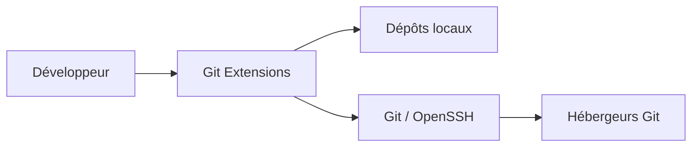
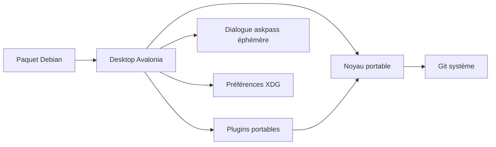

# C4 — migration Linux

## C1 · Contexte

Le développeur inspecte et modifie ses dépôts locaux ; les échanges distants passent par Git et les moyens d'authentification déjà configurés. Ne pas créer une seconde gestion des identifiants.

## C2 · Conteneurs

Application de bureau locale ; aucun serveur à déployer. Avalonia remplace progressivement WinForms ; `.deb` embarque le runtime .NET. L'ancienne solution Windows reste un repère fonctionnel pendant le portage.

## C3 · Composants / chemins

| Rôle | Point d'entrée |
| --- | --- |
| Build portable | `GitExtensions.Linux.slnx`, `src/linux/Directory.Build.props` |
| Navigation et workflows | `src/linux/GitExtensions.Desktop/` |
| Repères visuels et palettes originales | `ClassicStyles`, `CommitDialog`, `src/app/GitUI/Themes/`, `src/app/GitUI/Resources/Icons/` |
| Plugins portés, contrat et règles originales | `src/linux/GitExtensions.Plugins/`, `src/plugins/` |
| Authentification sans stockage de secrets | `AskpassApplication`, `gitextensions-askpass`, `GitRunner` |
| Processus et modèles Git | `src/linux/GitExtensions.Core/` |
| Contrats et parsers historiques réemployables | `src/app/GitCommands/`, `src/app/GitExtensions.Extensibility/` |
| Intégration bureau et paquet | `setup/linux/`, `eng/linux/` |
| Preuves comportementales | `tests/linux/`, `.github/workflows/linux.yml` |
| Référence du périmètre historique | `src/app/GitUI/IGitUICommands.cs`, `src/app/GitUI/CommandsDialogs/`, `src/plugins/` |

C4 · Le détail des classes est dans le code ; pas de diagramme qui le duplique.
